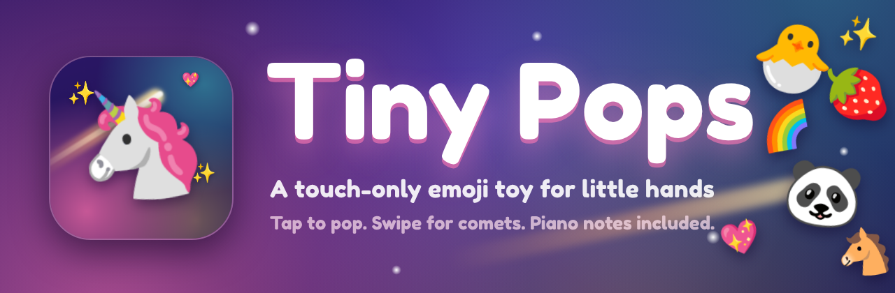
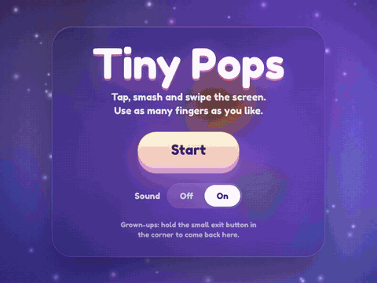
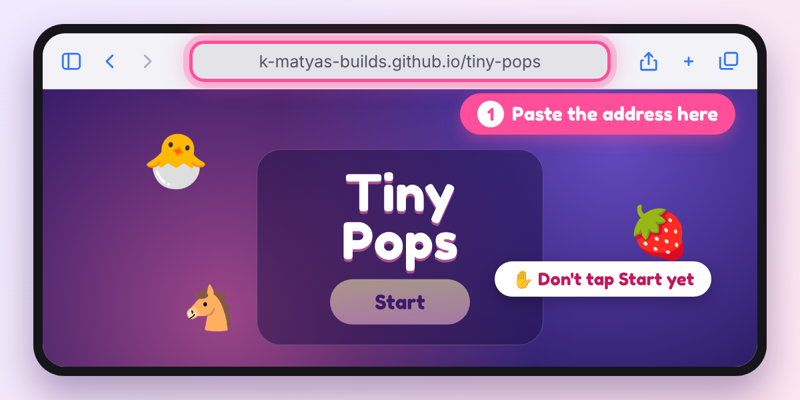
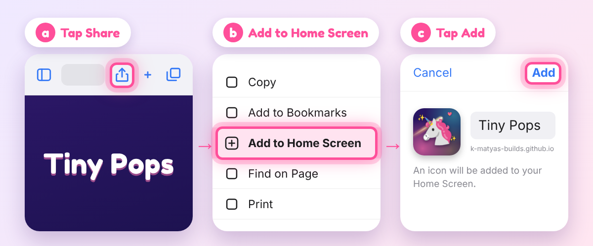
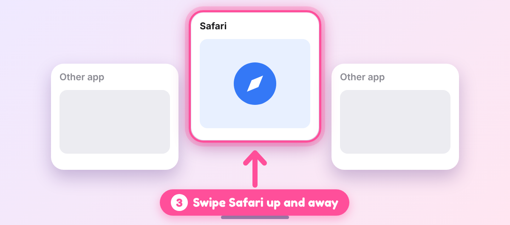
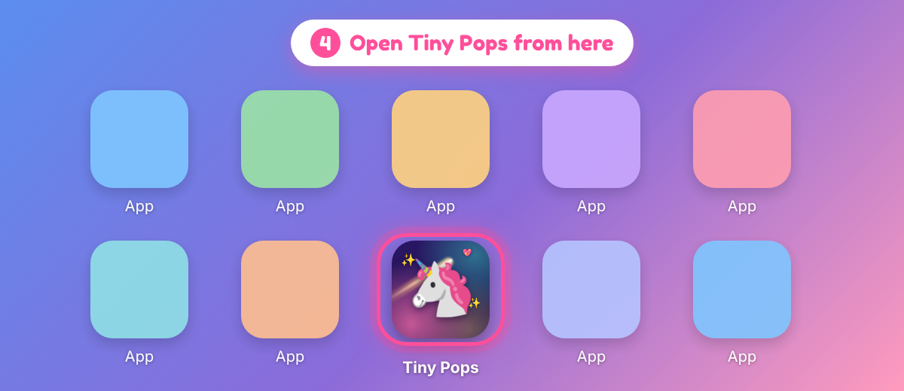

<p align="center">
  
</p>

<p align="center">
  
</p>

**Tap** the screen and a cute emoji pops. **Swipe** and a glowing comet follows the finger. Use as many fingers as you like.

No letters, no ads, no accounts. Made for iPad. Works on iPhone too.

---

## Set it up in 2 minutes

> ### ⚠️ Do the steps first. Don't tap Start in Safari.
> Add it to your Home Screen, then open it from there.
> (Safari's own full-screen mode can pop up a "fake keyboard" warning.)

### 1. Open the address in Safari

Copy this into **Safari** on your iPad or iPhone:

```
https://k-matyas-builds.github.io/tiny-pops/
```



### 2. Add it to your Home Screen

Tap **Share**, then **Add to Home Screen**, then **Add**.



> Can't see *Add to Home Screen*? Scroll down in the Share menu. On iPhone, the Share button is in the bottom bar.

### 3. Close Safari

Swipe up from the bottom edge, pause, then flick Safari upward.



### 4. Open Tiny Pops from your Home Screen

Tap the 🦄 icon, then tap **Start**. That's it!



---

## Good to know (for grown-ups)

- **How to leave:** hold the small **hold to exit** button in the top-right corner for about 1.5 seconds. A quick tap does nothing, so little hands can't leave by accident.
- **Sound:** there's an Off / On switch on the first screen, and it remembers your choice. Taps play soft piano notes and swipes make a little twinkle. It follows the iPad's volume.
- **Keep little hands inside the app:** turn on **Guided Access** (Settings → Accessibility → Guided Access), then triple-click the top button to start it. This also blocks the swipe-up and app-switcher gestures that a web page can't stop.
- **Privacy:** no accounts, no ads, no analytics. The only thing saved on the device is your sound on/off choice. The page loads one font from Google Fonts.

---

## Already set up?

Just use the icon on your Home Screen.

Link to the app: **[Tiny Pops](https://k-matyas-builds.github.io/tiny-pops/)**
(Opening it from here uses Safari, so for the full-screen experience use the Home Screen icon.)

---

<sub>Inspired by [Tiny Fingers](https://github.com/hashmil/tinyfingers) by Hash Milhan. Tiny Pops is a separate, touch-first take: one file of plain HTML, CSS and JavaScript, with the sounds generated in the browser.</sub>
